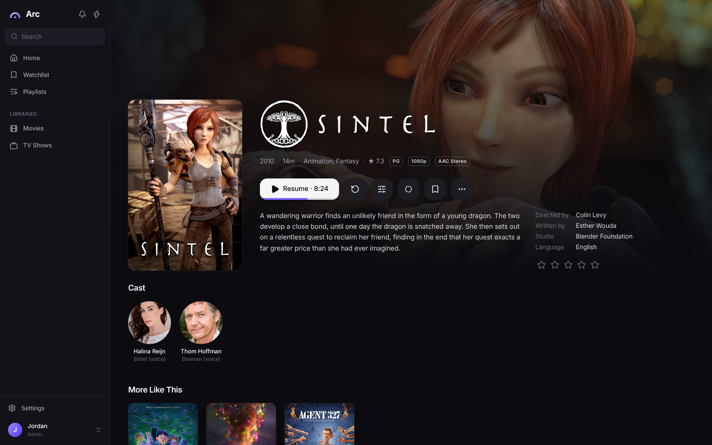
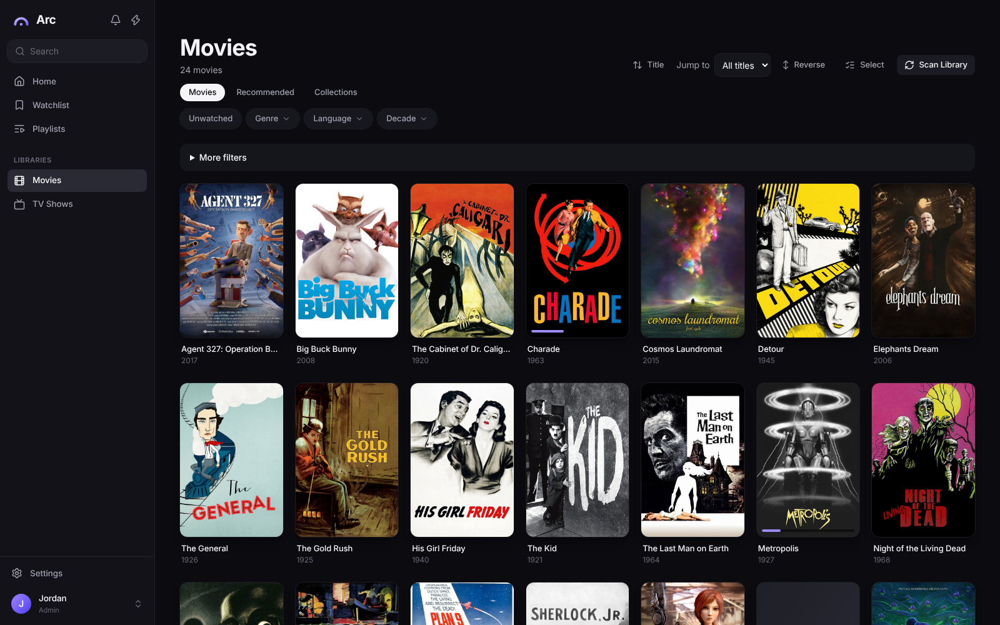
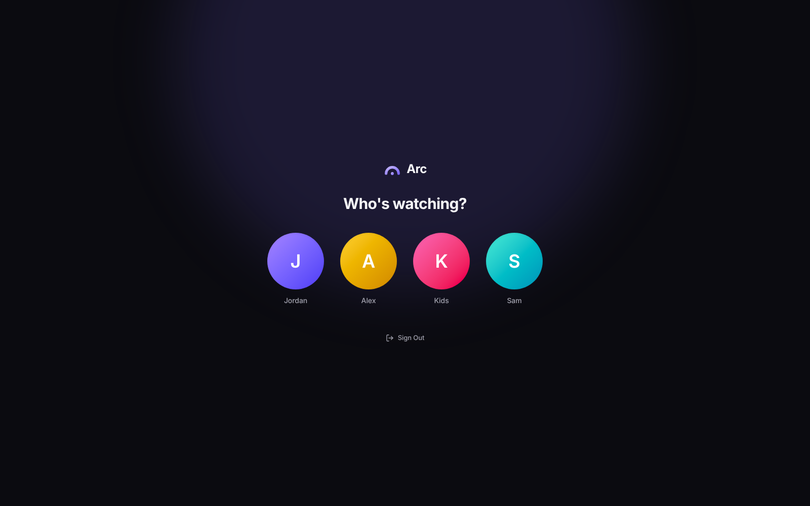

<p align="center">
  <picture>
    <source media="(prefers-color-scheme: dark)" srcset="docs/brand/arc-logo-stacked-white.svg">
    
  </picture>
</p>

<p align="center">
  <strong>Your films, shows and home videos, beautifully organised and ready to play anywhere.</strong>
</p>

<p align="center">
  
  
  
  
  
</p>

<p align="center">
  
</p>

## What is Arc?

Arc is a media server you run at home. Point it at the folders where your films and shows live
and it turns them into a library you'd be happy to browse: posters and artwork, cast and crew,
seasons in the right order, and everything ready to play in a browser on your TV, laptop or phone,
at home or away.

It's built for people who love Plex and Jellyfin but want something that feels calmer and more
polished: good automatic choices, settings in the app instead of config files, and a design that
gets out of the way of what you're watching. Arc is open source, has no plugins to manage, and
no tracking or telemetry.

<table>
  <tr>
    <td width="50%"></td>
    <td width="50%"></td>
  </tr>
  <tr>
    <td width="50%"></td>
    <td width="50%"></td>
  </tr>
</table>

## What makes it different

**🎞️ Your files stay yours.** Arc only ever reads your media. It never renames, moves, tags or
writes beside a file, so Sonarr, Radarr and everything else that depends on your folders keeps working.

**📺 Watch shows in the order you want.** Files stay numbered however they are on disk, and each
show can be watched in any order TMDB or TheTVDB knows: as aired, DVD, absolute, story order,
anime cours, or one you arrange yourself. Each person in the house can pick their own.

**▶️ Plays anywhere, at its best.** Arc plays a file untouched when the device can, and converts
it on the fly when it can't, using your graphics card if you have one. Skip intros and credits,
cast to a Chromecast or AirPlay, and keep going where you left off on another screen.

**👨‍👩‍👧 Made for a household.** Everyone gets a profile with their own home screen, watch history,
watchlist and recommendations. Kids' profiles only see what suits them, and friends can join with
an invite link and see only the libraries you share.

**🔍 Nothing silently disappears.** Titles Arc can't identify, episodes it can't place and files
that have gone missing are shown and listed, never hidden. A drive going offline doesn't cost
anyone their watch history.

**🛠️ Looks after itself.** Scans, artwork, intro detection, backups and database upkeep happen in
the background, overnight when they're heavy. An Activity menu and dashboard show what's going
on when you want to know.

**🔌 An open API.** Arc's own web app uses the same documented API any app can build on, and
native TV and phone apps are planned.

> **Status: alpha.** Arc runs day to day on a home server (Docker), and work is now
> focused on stability and release readiness. Expect rough edges, and keep backups of your Arc data
> folder (your media is never touched).

<details>
<summary><strong>Everything Arc can do</strong></summary>

**Libraries and metadata**
- Movie, TV and Other videos libraries, added in the app with a folder browser. Scanning runs in
  the background: titles show with posters within seconds, file details follow.
- Matching from TMDB and TheTVDB with Plex/Jellyfin-style naming, scene release names and
  `{tmdb-123}` / `{imdb-tt…}` tags. Fix Match shows exactly what Arc read and searched for.
- Cast and crew, studios, scores (Rotten Tomatoes and Metacritic with an OMDb key; metadata-provider scores otherwise), age ratings for each
  library's region, and metadata in 35+ languages, set per library.
- Edit anything; edited fields are locked so refreshes never undo them. Choose or upload
  posters, backgrounds, logos and season posters. Local artwork and NFO IDs are respected.
- Versions and editions (4K and 1080p, Director's Cut), extras and trailers, theme music.
- Collections (automatic from TMDB, manual and smart), labels, merge and split titles or
  shows, and a folder view for home videos.
- Library Health: unidentified titles, unreadable or missing files, duplicates, missing
  episodes, skip-marker coverage and how each library plays in each browser.

**Playback**
- Direct play when the browser can, otherwise remuxing or conversion to HLS, with hardware
  encoding (NVIDIA, Intel Quick Sync, AMD, VA-API, VideoToolbox) and HDR tone mapping.
- Automatic quality that adapts to the connection, optimized versions for weak devices, and
  remote bandwidth limits.
- Subtitles in the file, beside it or from OpenSubtitles, with per-profile styling and timing.
- Skip Intro, Recap and Credits from chapters, IntroDB/TheIntroDB, or audio and picture
  detection overnight. Auto-Play, Up Next, chapters, Picture-in-Picture, a playback queue.
- Chromecast and AirPlay from the web player.
- Dolby Vision, HDR10+, Atmos and DTS:X labels from the source files.

**Profiles and home**
- Plex Home-style profiles with optional PINs, a "Who's watching?" screen, and sign-in without
  a password at home (including Tailscale/VPN networks).
- Friends with invite links, library access per profile and parental controls by age.
- Each profile arranges its own Home: Continue Watching, Up Next, custom and seasonal rows,
  collections and playlists. Watchlist, ratings, recommendations, New for You and Year in Review.
- Playlists and smart playlists, search with typo forgiveness, person pages.
- The app is in English for now. All of its text is ready for translation, and more languages
  with a language picker are planned; see [translating Arc](docs/TRANSLATION.md) to help.

**Running the server**
- Remote access with UPnP and HTTPS (your own certificate or Let's Encrypt) on one port, and
  trusted reverse proxies.
- Dashboard with now playing, resource graphs and the server log; Insights for watch history
  and storage; an Activity menu for background work.
- Scheduled maintenance in a quiet window: metadata refresh, previews, intro detection,
  database backups and optimization, cache clean-up and optional empty trash.
- Daily database backups with one-click restore, webhooks (Discord, Slack, JSON) and redacted
  diagnostic downloads.
- Moving in from Plex or Jellyfin: watch state, resume points, ratings, watchlists, playlists
  and collections.
- The web app installs to a phone's home screen, and TVs sign in with a short link code.

</details>

## Running with Docker

An image for amd64 and arm64, with FFmpeg included, is published to
`ghcr.io/arc-media-server/arc-media-server`. `latest` follows `main` (the development channel); version
tags pass the full verification suite. See [image publishing](docs/IMAGE-PUBLISHING.md).

1. Copy [`docker-compose.yml`](docker-compose.yml), set your media folders (mounted read-only)
   and run `docker compose up -d`.
2. Open `http://<that computer>:8099`. First-run setup creates your admin profile and takes
   your free [TMDB](https://www.themoviedb.org/settings/api) and
   [TheTVDB](https://thetvdb.com/api-information) API keys. Then add `/media/movies` and
   `/media/tv` as libraries.

Notes:
- Everything Arc keeps (database, artwork, uploads, backups, logs) lives in `/config`.
- Host networking is recommended on Linux so Arc sees devices' real addresses (for sign-in at
  home) and can open the router port. Docker Desktop on Windows or Mac uses `ports: ["8099:8099"]`.
- For hardware encoding pass `/dev/dri` (Intel/AMD) or use the NVIDIA Container Toolkit; both are
  in the example file.
- Arc runs as the account in `PUID`/`PGID` (default `1000`/`1000`; on Unraid use `99`/`100`), never
  as root. On start it gives its own `/config` folder to that account, including an older install's
  root-owned files, and adds the groups of any `/dev/dri` devices for hardware conversion. Media
  and other mounts are never changed. Docker's `--user` (Compose `user:`) also works; then the
  config folder must already be writable by that user. See [container permissions](docs/CONTAINER-PERMISSIONS.md).
- Keep `/config` on local storage; media can be on network shares. SQLite can't share a database
  over a network filesystem.
- Behind a reverse proxy (SWAG, Nginx Proxy Manager, Caddy…), have it set `X-Forwarded-For` and
  `X-Forwarded-Proto`, and add its address under Settings › Network › Trusted proxies so people at
  home still count as home.

### Backups and upgrades

Built-in backups cover the database. Before upgrading, stop Arc and copy the whole `/config`
folder somewhere safe; it also holds uploaded artwork and certificates. Arc backs up its database
automatically before any upgrade that changes it, and an older Arc refuses to open a newer
database. The [recovery guide](docs/RECOVERY.md) covers restoring and rolling back.

## Building from source

You need Go 1.27+, Node.js 24 LTS (or 22.12+) and FFmpeg (`ffprobe` and `ffmpeg`).

```sh
cd web && npm ci && npm run build && cd ..   # the web app is embedded in the binary
go run ./cmd/ams                                  # serves http://127.0.0.1:8099
```

- `-data <folder>` (or `AMS_DATA`) sets where Arc keeps its data (default `./data`).
- `ams -reset-password` sets a new admin password if you've forgotten it.
- `AMS_TMDB_API_KEY`, `AMS_TVDB_API_KEY`, `AMS_FFPROBE` and `AMS_LISTEN` override the app's
  settings, for containers.
- Troubleshooting: Settings › Maintenance & diagnostics turns on detailed logging for 2 hours
  and downloads redacted logs, request-stage snapshots and bounded runtime call stacks.
  `-debug` enables the same two-hour window at startup.

For media features, Arc's container uses pinned Jellyfin FFmpeg 8.1.3. Source installations
should use that tested generation; hardware/tone-mapping support depends on the build and device.
Other FFmpeg versions are not established by the container's checks.

### Development

Start with the [package layout and build instructions](CLAUDE.md#layout). `cmd/ams` owns process lifetime,
`api` owns request policy, `store` owns catalog reservations and writes, and managers own background work
after the response. Reserve the catalog before capturing mutable item/file identities.

- `cd web && npm run dev` serves the web app with hot reload, forwarding API calls to a running
  server.
- `go vet ./... && go test ./...` for the server. `cd web && npm run test:e2e` runs the browser
  journeys (Playwright Chromium) against a real server with generated clips, local metadata
  fixtures and a fresh temporary database each test, never your own data.
- `go run ./tools/testmedia -out ../ams-test-media` makes a small test library, including shows
  with tricky episode orders.
- UI text goes through react-i18next; see [translation](docs/TRANSLATION.md).
- [ROADMAP.md](ROADMAP.md) has the plan and [docs/READINESS.md](docs/READINESS.md) the release
  checklist.

The server is Go with SQLite (pure Go, no CGO). The web app is React, TypeScript, Tailwind CSS,
Radix UI, Motion and TanStack Query.

## API

Everything the web app does goes through a documented REST API, with stable `/api/v1/...` paths,
Bearer tokens for apps and link codes for TVs. Start with the [client integration walkthrough](docs/CLIENT-INTEGRATION.md), also bundled at
`/docs/client-integration.html`. The endpoint reference is [docs/API.md](docs/API.md),
generated from the code, and a running server describes itself at `/api/openapi.json`.
See [artwork and collection automation](docs/AUTOMATION.md) for integration examples and
[remote quality](docs/REMOTE-QUALITY.md) for playback limits and upload measurements.

Apps can request [server-generated artwork palettes](docs/ARTWORK-PALETTES.md) for ambient backgrounds.

## Credits

Movie and TV information and images come from [TMDB](https://www.themoviedb.org) and
[TheTVDB](https://thetvdb.com), credited in the app wherever their information is shown.
This product uses the TMDB API but is not endorsed or certified by TMDB.
Skip markers can also come from [IntroDB](https://introdb.app) and
[TheIntroDB](https://theintrodb.org), subtitles from [OpenSubtitles.com](https://www.opensubtitles.com),
and critics' scores from [OMDb](https://www.omdbapi.com).

## Licence

Copyright © 2026 The Arc Media Server Authors.

Arc is free software: you can redistribute it and/or modify it under the terms of the
[GNU Affero General Public License, version 3](LICENSE). In short: you can use, change and share
Arc freely; if you distribute a modified version, or run one as a service for other people, you
must make your source code available under the same licence. Apps that only talk to Arc's API
are not affected and can use any licence.
