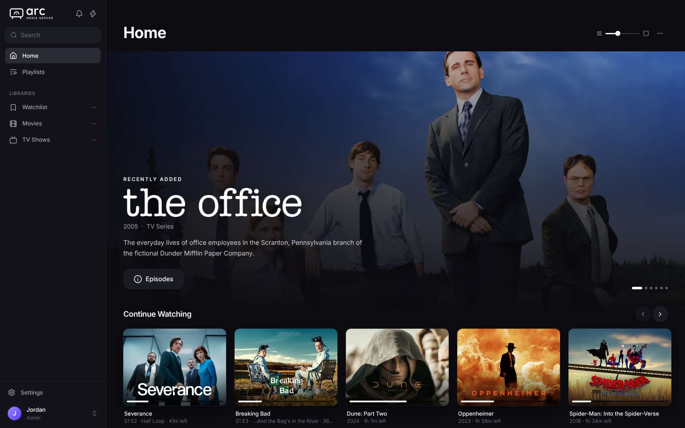
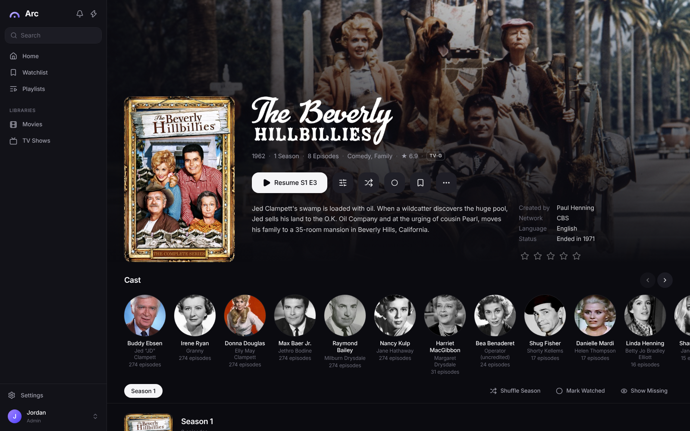

<p align="center">
  <picture>
    <source media="(prefers-color-scheme: dark)" srcset="docs/brand/arc-logo-stacked-white.svg">
    
  </picture>
</p>

<p align="center">
  <strong>Your films, shows and home videos, organised and ready to watch.</strong>
</p>

<p align="center">
  
  
  
  
  
</p>

<p align="center">
  
</p>

## What is Arc?

Arc is a media server you run on your own computer or home server. Add your movie, TV and
home-video folders, then browse and watch through the web app. Posters, metadata, episode
orders and watch history are kept in Arc's own data folder; your media stays untouched.

Arc uses automatic defaults and in-app settings, with no plugins to manage and no built-in
analytics or telemetry.

> **Alpha software.** The current focus is stability and release readiness. Start with the web
> app; native client projects are in development and readiness varies by platform. Keep backups
> of Arc's data folder. See the [roadmap](ROADMAP.md) and [release checklist](docs/ALPHA-CHECKLIST.md).

<table>
  <tr>
    <td width="50%"></td>
    <td width="50%"></td>
  </tr>
  <tr>
    <td width="50%"></td>
    <td width="50%"></td>
  </tr>
</table>

<sub>Artwork and details from <a href="https://www.themoviedb.org">TMDB</a>. Films and shows are
Creative Commons or public domain.</sub>

## What makes it different

**🎞️ Your files stay yours.** Arc only ever reads your media. It never renames, moves, tags or
writes beside a file, so Sonarr, Radarr and everything else that depends on your folders keeps working.

**📺 Episode order without renaming files.** Keep file numbering separate from how a show is
watched. Administrators can choose provider orders such as aired, DVD or absolute, or arrange
one themselves. The display order is shared across profiles.

**▶️ Playback that adapts.** Direct-play compatible files, remux or convert when needed, and use
hardware encoding when available. Resume on another signed-in screen, choose audio/subtitles,
and skip intros and credits. Codec, HDR and casting support depend on the browser and device.

**👨‍👩‍👧 Made for a household.** Everyone gets a profile with their own home screen, watch history,
watchlist and recommendations. Kids' profiles only see what suits them, and friends can join with
an invite link and see only the libraries you share.

**🔍 A library you can repair.** Unmatched titles and unplaced episodes remain accessible.
Missing files are reported in Library Health, with their records and watch history retained;
unavailable media is excluded from normal playable listings.

**🛠️ Background work you can follow.** Scanning and matching run in the background. Scheduled
maintenance controls optional work, and Activity and Dashboard show progress and problems.

**🔌 An open API.** The server provides documented, versioned endpoints for the web app,
native clients and integrations. [Start building a client](docs/CLIENT-INTEGRATION.md).


## Running with Docker

The image at `ghcr.io/arc-media-server/arc-media-server` supports amd64 and arm64 and includes
FFmpeg. **`latest` is the development channel**: code changes on `main` publish without the full
release gates. Version-tag publication requires full verification. See [image publishing and
registry access](docs/IMAGE-PUBLISHING.md).

1. Copy [`docker-compose.yml`](docker-compose.yml) into a working folder. Replace the host media
   paths, review the time zone and choose the account IDs for your installation.
2. From that folder, pull and start the image:

   ```sh
   docker compose pull
   docker compose up -d
   ```

3. Open `http://<server-address>:8099` and create your administrator profile. Metadata-provider
   credentials are optional during setup and can be added later under **Settings → Libraries &
   metadata**. Matching needs access to the provider you choose for the library.
4. Add libraries using the container paths, such as `/media/movies` and `/media/tv`, rather than
   the host's original paths.

[TMDB](https://www.themoviedb.org/settings/api) and [TheTVDB](https://thetvdb.com/api-information)
have their own access requirements. Arc does not supply provider keys. See
[provider requirements](docs/DISTRIBUTION.md), including TheTVDB project and licensing options.

### Storage, networking and hardware

- Persist `/config`: it holds Arc's database, artwork, uploads, backups, logs and certificates.
  Keep it on local storage; media can be on network shares. SQLite's live database should not
  be placed on a network filesystem.
- Arc normally runs as `PUID:PGID` (`1000:1000` by default; commonly `99:100` on Unraid). The
  entrypoint briefly uses root to prepare Arc's own config ownership and device groups before
  starting the server as that account. Media mounts stay untouched. Docker's `--user` / Compose
  `user:` is supported when config permissions and device groups are prepared already.
  See [container permissions](docs/CONTAINER-PERMISSIONS.md).
- Host networking is recommended on Linux. On Docker Desktop, remove `network_mode: host` and
  enable the example `ports: ["8099:8099"]` mapping instead. Bridge/VPN setups may need your LAN
  or VPN subnet added under **Settings → Access & devices → Network → Home networks**.
- Pass `/dev/dri` for Intel/AMD hardware encoding, or use the NVIDIA Container Toolkit; the
  Compose example includes both. Exposing a device alone does not guarantee encoder support.
- For a reverse proxy, forward `X-Forwarded-For` and `X-Forwarded-Proto` and configure its address
  under **Settings → Access & devices → Network → Trusted proxies**. Remote access also needs
  a reachable server address and appropriate router/proxy configuration.

### Backups and upgrades

Built-in backups cover the database. Before upgrading, stop Arc and copy the whole `/config`
folder somewhere safe; it also holds uploaded artwork and certificates. Arc backs up its database
automatically before any upgrade that changes it, and an older Arc refuses to open a newer
database. The [recovery guide](docs/RECOVERY.md) covers restoring and rolling back.

## Building from source

You need Go 1.27+, Node.js 24 LTS and `ffprobe`/`ffmpeg` on your path. The container uses pinned
Jellyfin FFmpeg 8.1.3; other builds may lack required hardware/HDR filters and are not covered by
that container's verification.

```sh
cd web && npm ci && npm run build && cd ..   # the web app is embedded in the binary
go run ./cmd/ams                                  # serves http://127.0.0.1:8099
```

- `-data <folder>` (or `AMS_DATA`) sets where Arc keeps its data (default `./data`).
- `ams -reset-password` sets a new admin password if you've forgotten it.
- `AMS_TMDB_API_KEY`, `AMS_TVDB_API_KEY`, `AMS_FFPROBE` and `AMS_LISTEN` override the app's
  settings, for containers.
- Troubleshooting: Settings › Maintenance & diagnostics turns on detailed logging for 2 hours
  and downloads redacted logs, request-stage snapshots and bounded runtime call stacks.
  `-debug` enables the same two-hour window at startup.

### Development

Start with the [shared development instructions](CLAUDE.md) for repository workflow, package
layout and build conventions. Changes go through pull requests.

- `cd web && npm run dev` serves the web app with hot reload, forwarding API calls to a running
  server.
- `go vet ./... && go test ./...` for the server. `cd web && npm run test:e2e` runs the browser
  journeys (Playwright Chromium) against a real server with generated clips, local metadata
  fixtures and a fresh temporary database each test, never your own data.
- `go run ./tools/testmedia -out ../ams-test-media` makes a small test library, including shows
  with tricky episode orders.
- UI text goes through react-i18next; see [translation](docs/TRANSLATION.md).
- [ROADMAP.md](ROADMAP.md) has the plan and [docs/READINESS.md](docs/READINESS.md) the release
  checklist.

The server is Go with SQLite (pure Go, no CGO). The web app is React, TypeScript, Tailwind CSS,
Radix UI, Motion and TanStack Query.

## API

The server exposes a documented REST API, with stable `/api/v1/...` paths,
Bearer tokens for apps and link codes for TVs. Start with the [client integration walkthrough](docs/CLIENT-INTEGRATION.md), also bundled at
`/docs/client-integration.html`. The endpoint reference is [docs/API.md](docs/API.md),
generated from the code, and a running server describes itself at `/api/openapi.json`.
See [artwork and collection automation](docs/AUTOMATION.md) for integration examples and
[remote quality](docs/REMOTE-QUALITY.md) for playback limits and upload measurements.

Useful integration guides:

- [Artwork palettes](docs/ARTWORK-PALETTES.md) for ambient backgrounds.
- [Watch Together](docs/WATCH-TOGETHER-API.md) room and playback coordination.
- [Original downloads](docs/DOWNLOADS-OFFLINE-API.md): server preparation, resumable transfer and
  offline bundles. Client download UI, offline progress sync and converted downloads remain
  separate work; these APIs alone do not make offline playback available in an app.

## Credits

Movie and TV information and images come from [TMDB](https://www.themoviedb.org) and
[TheTVDB](https://thetvdb.com), credited in About and matched-title pages.
This product uses the TMDB API but is not endorsed or certified by TMDB.
Skip markers can also come from [IntroDB](https://introdb.app) and
[TheIntroDB](https://theintrodb.org), subtitles from [OpenSubtitles.com](https://www.opensubtitles.com),
and critics' scores from [OMDb](https://www.omdbapi.com).

## Licence

Copyright © 2026 The Arc Media Server Authors.

Licensed under the [GNU Affero General Public License, version 3 only](LICENSE).
