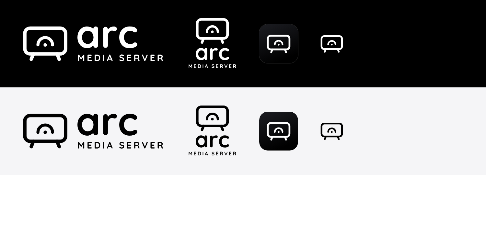

# Arc brand

The owner's chosen logo (November 2026): a TV on little feet with Arc's original arc and dot
inside, and the name in Quicksand Bold, lowercase "arc" with "MEDIA SERVER" in spaced capitals.
White on black first; black on white where the background is light. No colour: the old teal
belonged to the previous logo.

| File | Use |
|---|---|
| `arc-logo-white.svg`, `arc-logo-black.svg` | The main logo: the TV with "arc" and "MEDIA SERVER" beside it, the text exactly as tall as the TV. Headers, sign-in, README, store listings. |
| `arc-logo-stacked-white.svg`, `arc-logo-stacked-black.svg` | The TV above the name, for square spaces: TV apps' sign-in and splash screens. |
| `arc-icon.svg` | The app icon: the white TV on a rounded black square, for places that show it as drawn. |
| `arc-icon-square.svg`, `arc-icon-1024.png` | The same icon as a full square, for places that round or mask the corners themselves: the web app's tab and home-screen icons (`web/public`), and the GitHub organisation's picture. |
| `arc-favicon.svg` | The browser tab icon: a bolder TV on a rounded black square, so it reads at 16px (`web/public/favicon.svg`). |
| `arc-mark-white.svg`, `arc-mark-black.svg` | The TV alone, on transparent: small places beside other text, over artwork. |

- The lettering is drawn as shapes, so the files need no font installed. The font is Quicksand
  Bold (SIL Open Font Licence), for anywhere text has to match.
- At small sizes "MEDIA SERVER" gets too small to read: use the mark or the icon there.
- Where it's used: the web app's sidebar and sign-in screens (the main logo, `web/src/components/ArcLogo.tsx`,
  drawn in the text colour so it follows light and dark), its phone bar (the mark), its tab and
  home-screen icons, and the top of the README (the stacked logo).
- Not done yet: the TV apps.
